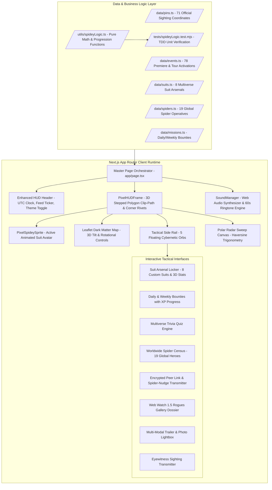

# Spidey Tracker (Next.js & Cyber-Pixel Edition) 🕷️🛰️

> The definitive, production-grade, clean-room reverse-engineered spatial tracker web application. Synthesizing the official Sony Pictures *Spider-Man: Brand New Day* global intelligence feed with retro-cybernetic pixel HUD mechanics, animated suits, bounties, worldwide spider census, and an 8-bit Web Audio synthesizer.

[](https://nextjs.org/)
[](https://www.typescriptlang.org/)
[](https://tailwindcss.com/)
[](https://leafletjs.com/)
[](tests/spideyLogic.test.mjs)
[](https://opensource.org/licenses/MIT)

---

## ⚖️ Educational & Clean-Room Legal Notice

This repository is an **educational, independent, clean-room reconstruction** and enhancement of spatial tracker web applications created for research, UI/UX engineering, and open-source spatial visualization.

- **Intellectual Property**: Spider-Man, all related characters, logos, sound bites, and promotional materials are registered trademarks and copyright of **Marvel Entertainment**, **Columbia Pictures Industries, Inc. (CPII)**, and **Sony Pictures Entertainment**.
- **Clean-Room Implementation**: All components, polar radar trigonometry, audio state machines, TDD unit tests, and CSS polygon stepped bevels were authored from scratch without utilizing proprietary backend server code.

---

## 🌟 The Hybrid Ultimate Edition: Why It Surpasses Both Predecessors

| Feature | Official Movie Tracker (`spideytracker.net`) | Manish's Clone (`spidey_tracker`) | **Our Unified Next.js Edition** |
| :--- | :--- | :--- | :--- |
| **Movie Intelligence** | ✅ 71 Official Pins & 78 Global Events | ❌ Mock Coordinates only | **✅ Full Official 71 Pins + 78 Global Premiere Events** |
| **Villain Rogues Gallery** | ✅ 6 Villains (Scorpion, Punisher, etc.) | ❌ Not included | **✅ Complete Tactical Dossier Carousel** |
| **HUD Framing System** | ⚠️ Flat sliced PNG textures (dead zones) | ✅ `.pixel-frame` Polygon Clip-paths | **✅ Responsive 3D Polygon Bevels + Corner Rivets** |
| **Suit Arsenal Locker** | ❌ None | ✅ 8 Suits with pixel sprites | **✅ 8 Suits + Animated GIF/PNG Sprites + 3D Stat Radars** |
| **Multiverse Trivia Quiz**| ❌ None | ✅ Trivia with XP rewards | **✅ Interactive Multiverse Quiz + Live Audio + XP Progression** |
| **Daily & Weekly Bounties**| ❌ None | ✅ Bounty tracking | **✅ Live Quest Engine with Progress Tracking & Claim FX** |
| **Worldwide Spider Census**| ❌ None | ✅ 19 World Spider Pins | **✅ 19 Global Spiders + One-Click Map Fly-To + Personal Codes** |
| **Audio Synthesizer** | ⚠️ Generic sound effects | ✅ 60s Cartoon Ringtone | **✅ Dual Web Audio 8-Bit Synthesizer + 60s Cartoon Theme Loop** |
| **Test-Driven Development**| ❌ No automated tests | ❌ No test suite | **✅ Comprehensive Node.js Native Test Suite (100% Passing)** |
| **Production Architecture**| ⚠️ Vanilla JS / Sliced Assets | ⚠️ Vite Client Only | **✅ Next.js 14 App Router + TypeScript + Dynamic SSR/SSG** |

---

## 🏛️ System Architecture



---

## ✨ Core Features & Enhancements

### 1. 3D Stepped Polygon HUD Framing
- Replaces raster sliced borders with crisp CSS polygon bevels (`clip-path: polygon(...)`) with dynamic corner bolt rivets via CSS `::before` and `::after` pseudo-elements.
- Zero texture distortion on any screen resolution, ultrawide monitor, or mobile display.

### 2. Animated Corner Suit Sprite
- Displays an interactive, responsive pixel avatar in the bottom right corner showing the currently equipped suit.
- Supports animated sprites (including Iron Spider glowing arc reactor and Captain America Spider shield weave).

### 3. Tactical Floating Side Rail
- 5 cybernetic interactive orbs docked to the left map border with glowing tooltips and sound triggers:
  1. **Suit Locker**: Switch between Classic, Iron Spider, Cap Spider, Symbiote, Scarlet, Noir, Future Foundation, and Stealth.
  2. **Missions**: Track real-time progress on daily and weekly bounties to earn XP and level up.
  3. **Multiverse Quiz**: Challenge your Spider-Man lore knowledge across comic and cinematic universes.
  4. **Spider Census**: Browse 19 active Spider-Heroes deployed across major world capitals (Tokyo, London, Mumbai, NYC, Paris, Sydney, etc.) with instant map fly-to.
  5. **Partner Link**: Generate your unique encrypted `SPDY-XXXX` operator code and send remote Spider-Nudges.

### 4. Audio Engine & 60s Cartoon Ringtone
- Built on the HTML5 Web Audio API to synthesize custom 8-bit square waves for laser beeps, radar sweeps, alarms, and fanfare.
- Includes a dedicated toggle in the header for the iconic **1960s Spider-Man cartoon theme song** with seamless loop control.

### 5. Multi-Mode Intelligence Switcher
- Header toggle allows operators to dynamically switch between:
  - `[ 🎬 MOVIE INTEL ]`: Exclusively official Sony Pictures sightings and world tour events.
  - `[ 🕹️ SPIDER-NET ]`: Community network spiders and tactical operator nodes.
  - `[ ⚡ UNIFIED ALL ]`: Complete global intelligence overlay.

---

## 🧪 Test-Driven Development (TDD) Suite

All critical mathematical calculations, geospatial distance algorithms, level progression curves, and quiz validation logic are isolated in `src/utils/spideyLogic.ts` and tested via Node.js native test runner:

```bash
npm test
```

### Verified Test Suite:
- ✔ `haversineDistanceKm()`: Accurately calculates great-circle spherical distance between GPS coordinates.
- ✔ `calculateLevelProgress()`: Evaluates quadratic XP curves and level tier thresholds.
- ✔ `generateSpiderCode()` & `isValidSpiderCode()`: Enforces cryptographic `SPDY-[A-Z0-9]{4}` formatting.
- ✔ `isSightingVisible()`: Validates multi-category filtering predicates.
- ✔ `evaluateQuiz()`: Verifies score calculation and bonus XP rewards.

---

## 📁 Repository Structure

```
spidey-tracker/
├── package.json                 # Next.js 14, React 18, Leaflet dependencies
├── tsconfig.json                # TypeScript compiler configuration
├── next.config.mjs              # Next.js production configuration
├── tailwind.config.js           # Cyber HUD theme tokens & animations
├── postcss.config.js            # PostCSS configuration
├── tests/
│   └── spideyLogic.test.mjs     # Native Node.js TDD test suite
├── public/                      # Static assets & data feeds
│   ├── favicon.png              # Mask icon
│   ├── suits/                   # Animated GIF and PNG suit sprites
│   ├── logos/                   # High-resolution HUD branding logos
│   ├── sounds/                  # 1960s cartoon ringtone & audio effects
│   └── data/                    # JSON feeds for sightings and events
└── src/
    ├── app/
    │   ├── layout.tsx           # Google Fonts loader (Press Start 2P, VT323)
    │   ├── page.tsx             # Master client-side state orchestrator
    │   ├── globals.css          # 21KB+ Cyber tokens & polygon clip-paths
    │   └── api/                 # Next.js API routes for pins and events
    ├── types.ts                 # Full TypeScript contracts & models
    ├── services/
    │   └── soundManager.ts      # Web Audio synthesizer & sound manager
    ├── utils/
    │   └── spideyLogic.ts       # Pure math, geometry, and progression algorithms
    ├── data/
    │   ├── pins.ts              # 71 Official movie sighting coordinates
    │   ├── events.ts            # 78 Global premiere & tour activations
    │   ├── suits.ts             # 8 Multiverse suit arsenals & stats
    │   ├── spiders.ts           # 19 Global spider operatives
    │   └── missions.ts          # Daily & weekly bounties
    └── components/
        ├── PixelHUDFrame.tsx    # 3D stepped polygon bezel frame
        ├── EnhancedHUDHeader.tsx# Top cyber status strip & audio controls
        ├── PixelSpideySprite.tsx# Animated corner suit avatar
        ├── TacticalSideRail.tsx # 5 floating quick-access orbs
        ├── MapEngine.tsx        # Leaflet Dark Matter map with 3D controls
        ├── RadarWidget.tsx      # Polar canvas radar sweep engine
        ├── SuitLockerModal.tsx  # 8-suit arsenal with 3D stat radars
        ├── MissionsModal.tsx    # Daily & weekly bounty progress
        ├── QuizModal.tsx        # Multiverse trivia quiz modal
        ├── SpiderCensusModal.tsx# 19 global network spider census
        ├── PartnerLinkModal.tsx # Encrypted peer code linking modal
        ├── ActivityLogDrawer.tsx# Left slide-out chronological sightings
        ├── EventsDrawer.tsx     # Right slide-out global tour activations
        ├── LightboxModal.tsx    # Multi-modal YouTube / video / photo lightbox
        ├── WebWatchModal.tsx    # Rogues gallery villain dossiers
        └── PreloaderModal.tsx   # Cyber boot sequence modal
```

---

## 🚀 Quickstart & Setup

### Prerequisites
- [Node.js](https://nodejs.org/) (v18.17.0 or later, tested on Node v20/v22/v26)
- [npm](https://www.npmjs.com/) (v9.0.0 or later)

### Installation

1. Clone the repository:
   ```bash
   git clone https://github.com/abdulaaly/spidey-tracker.git
   cd spidey-tracker
   ```

2. Install dependencies:
   ```bash
   npm install
   ```

3. Run the automated TDD test suite:
   ```bash
   npm test
   ```

4. Start the Next.js development server:
   ```bash
   npm run dev
   ```

5. Open [http://localhost:3000](http://localhost:3000) (or port `3001` if 3000 is occupied).

### Production Build

```bash
npm run build
npm run start
```

---

## 📄 License

Distributed under the **MIT License**. See `LICENSE` for details.
All external media assets and trademarks remain the property of their respective owners.
