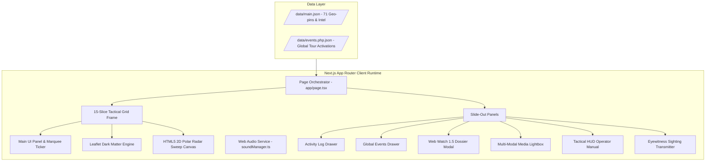

# Spidey Tracker (Next.js Edition) 🕷️🛰️

> A production-grade, clean-room reverse-engineered spatial tracker web application built with **Next.js 14 (App Router)**, **TypeScript**, **Tailwind CSS**, and **Leaflet Dark Matter**.

[](https://nextjs.org/)
[](https://www.typescriptlang.org/)
[](https://tailwindcss.com/)
[](https://leafletjs.com/)
[](https://opensource.org/licenses/MIT)

---

## ⚖️ Educational & Clean-Room Legal Notice

This repository is an **educational, independent, clean-room reconstruction** of the tactical spatial tracker web experience created for research, UI reverse engineering demonstration, and open-source spatial application design.

- **Intellectual Property**: Spider-Man, all related characters, logos, sound bites, and promotional materials are registered trademarks and copyright of **Marvel Entertainment**, **Columbia Pictures Industries, Inc. (CPII)**, and **Sony Pictures Entertainment**.
- **Clean-Room Implementation**: All components, polar radar trigonometry, audio state machines, and CSS polygon stepped bevels were authored from scratch without utilizing proprietary backend server code.

---

## 🏛️ System Architecture



---

## ✨ Features & Capabilities

1. **15-Slice Tactical Cyber Frame**:
   - Reconstructs the 3-column by 5-row CSS grid boundary (`grid-template-columns: 36px 1fr 36px; grid-template-rows: 36px 1fr 19px 50px 7px;`).
   - Uses mathematical polygon clip-paths (`bit-border-3step`, `bit-border-2step`, `bit-border-2top3bottom`) for 8-bit stepped bevel corners without raster button artifacts.

2. **Real-Time Polar Radar Sweep Engine**:
   - High-performance HTML5 2D canvas computing distance via the **Haversine formula** and polar bearing relative to the current map viewport center and zoom level.
   - Color-coded blips for Confirmed, Rumored, Trailer, and Watch Party sightings.
   - Interactive quick actions: **Zoom to Global** view and **Center Neighborhood** (HTML5 Geolocation).

3. **Spatial Map Engine (Leaflet Dark Matter)**:
   - Zero-API-key dark monochrome vector tiles (CartoDB Dark Matter) matching the tactical HUD style.
   - Custom HUD pins with glowing markers and dynamic pin card popups (`.pin-card-dyn`).
   - Simulated 3D perspective camera controls: Tilt Up/Down and Rotate Clockwise/Counter-Clockwise.

4. **Activity Log Drawer**:
   - Left slide-out drawer sorting sightings in chronological order.
   - Category filtering chips: **Confirmed**, **Rumored**, and **Watch Party**.
   - Clicking any sighting triggers a fly-to animation on the map and opens the media card.

5. **Web Watch 1.5 Rogues Gallery**:
   - Tactical carousel dossier modal detailing intelligence on **Scorpion**, **Boomerang**, **Tarantula**, **The Hand**, **Punisher**, and **Jean Grey**.
   - Dot pagination and previous/next navigation with stepped border portrait cards.

6. **Global Tour & Events Drawer**:
   - Right slide-out panel cataloging worldwide tour dates, red carpet photocalls, and stadium installations.
   - Media attachments (photos, videos, locations) with direct `VIEW ON MAP` coordination.

7. **Multi-Modal Lightbox**:
   - Embedded YouTube player for trailers and transmissions.
   - Native HTML5 video player and high-resolution photo gallery.
   - Collapsible bottom video playlist carousel.

8. **Web Audio Sound Engine**:
   - Web Audio API / HTML5 Audio controller with sound categories (`preloader`, `activity`, `webwatch`, `events`, `notification`).
   - Global sound mute/unmute toggle persisted in `localStorage`.

9. **Eyewitness Sighting Transmitter**:
   - Modal form allowing users to submit new custom sightings with latitude, longitude, classification, and eyewitness notes directly into the live radar and map.

---

## 🚀 Quickstart & Setup

### Prerequisites
- Node.js (v18.17.0 or later)
- npm

### Installation

```bash
git clone https://github.com/abdulaaly/spidey-tracker.git
cd spidey-tracker
npm install
npm run dev
```

Open `http://localhost:3001` in your browser.
